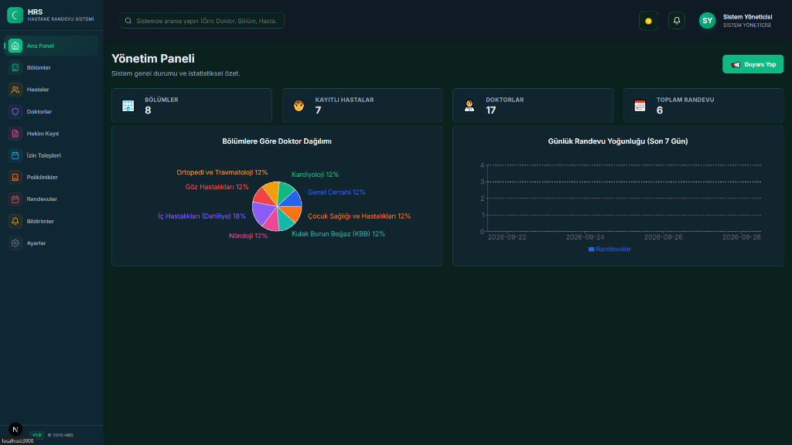
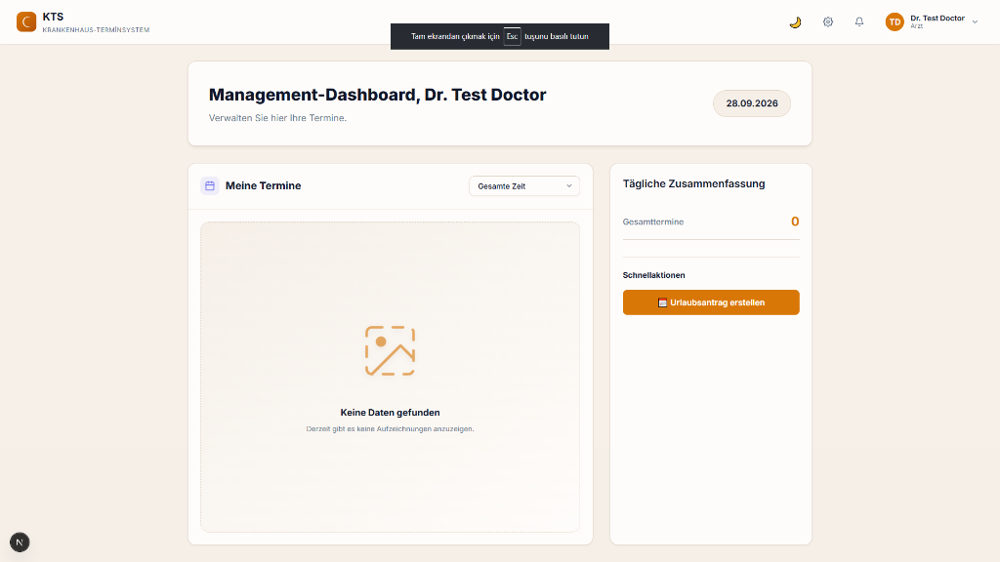
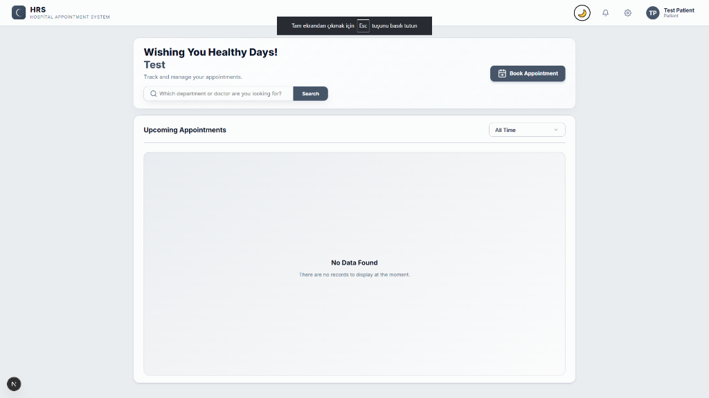
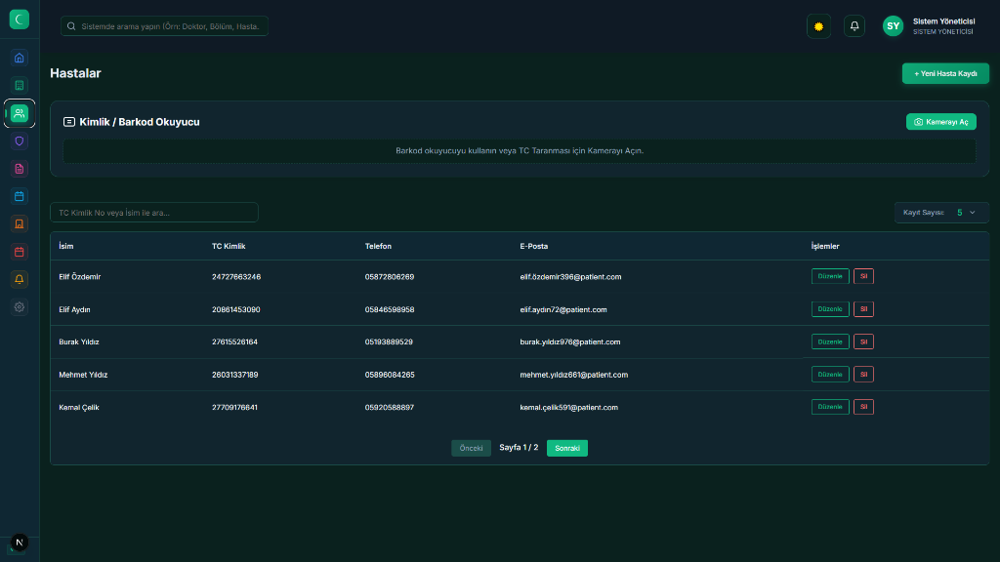
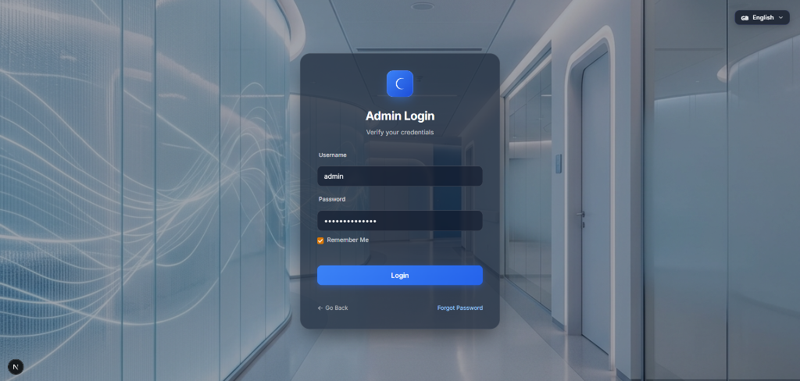
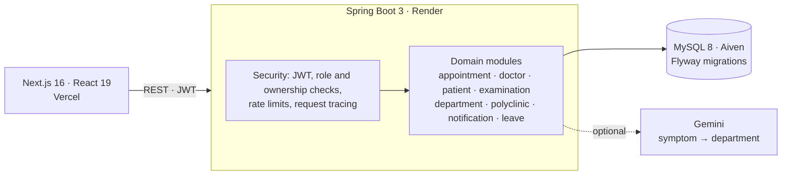

<div align="center">


# Hospital Management System

**Appointments, examinations and hospital organisation for patients, doctors and administrators.**

[](https://github.com/akifkeklik/hospital-management-system/actions/workflows/build.yml)
[](LICENSE)


[**Live demo**](https://hospital-management-system-rho-flax.vercel.app/) · [Postmortem: why the site went down without a code change (TR)](https://medium.com/@akifkeklik/kod-de%C4%9Fi%C5%9Fmedi%C4%9Fi-halde-site-neden-%C3%A7%C3%B6kt%C3%BC-bir-hastane-randevu-sisteminden-ger%C3%A7ek-dersler-f712205ec386) · [Full reference](docs/REFERENCE.md)



</div>

> **Live demo note:** the API runs on Render's free tier, which sleeps when idle. The first visit can show
> "Sunucu uyandırılıyor" (server waking up) for about a minute; after that the app responds normally.

## What it does

| Role | Can |
|---|---|
| **Patient** | Register, book and cancel appointments by department and doctor, see examination history, get notifications, describe symptoms to an optional AI department router |
| **Doctor** | See the daily schedule, record examinations, diagnoses and prescriptions, request leave |
| **Admin** | Manage departments, polyclinics, doctors and patients, approve doctor requests and leave, configure working hours and appointment length |

Doctor availability is checked and conflicting bookings are prevented.

<table>
<tr>
<td width="50%"><br /><sub><b>Doctor:</b> today's appointments and leave requests</sub></td>
<td width="50%"><br /><sub><b>Patient:</b> upcoming appointments, department and doctor search</sub></td>
</tr>
<tr>
<td><br /><sub><b>Admin:</b> patient records with barcode lookup</sub></td>
<td><br /><sub>Separate entry points per role</sub></td>
</tr>
</table>

## Architecture



A modular monolith: each domain has its own `api`, `impl` and `web` packages. Authorization is checked per
endpoint with `@PreAuthorize`, including ownership rules (a patient sees only their own appointments).

| Area | Technologies |
|---|---|
| Backend | Java 17, Spring Boot 3, Spring Security, Spring Data JPA, Flyway, Actuator + Prometheus |
| Frontend | Next.js 16, React 19, eight interface languages |
| Data | MySQL 8 in production, H2 in tests |
| Quality | JUnit 5, Mockito, Spring Security Test, JaCoCo, GitHub Actions, Docker |

## Run locally

Requires Java 17, Maven, Node.js and Docker (or a local MySQL 8).

```bash
cp .env.example .env          # set ADMIN_PASSWORD, JWT_SECRET and the database values
docker compose up -d --build  # Spring Boot on :8080, MySQL on :3307
cd frontend && npm ci && npm run dev   # http://localhost:3000
```

In the `dev` profile, test users are created (doctor `88888888888`, patient `99999999999`, password from
`TEST_USER_PASSWORD`). The admin password always comes from `ADMIN_PASSWORD`; there is no default.

## Quality

```bash
mvn verify                           # 218 backend tests on H2, external services mocked
cd frontend && npm run lint && npm test && npm run build   # 13 frontend unit tests
```

CI runs both on every push. Coverage reports are produced by JaCoCo in `target/site/jacoco`.

## Status and known limits

This is a portfolio project, not a certified medical system.

- **Schema management:** Flyway runs the migrations, but `ddl-auto` still defaults to `update` because the
  production schema was first created by Hibernate. Switching the default to `validate` needs a baseline
  migration that matches production first; see the postmortem.
- **Frontend:** JavaScript. Unit tests cover the API client, error translation and translations: every
  language must have every key, and every key the code uses must exist. Screens themselves are checked
  manually; there are no browser tests yet.
- **AI symptom routing** is a suggestion for which department to see, never a diagnosis. Without
  `GEMINI_API_KEY` it uses a built-in demo fallback.

Configuration, API endpoints, security controls, deployment and password reset are documented in
[docs/REFERENCE.md](docs/REFERENCE.md).

## License

[MIT](LICENSE) · Built by [Akif Keklik](https://github.com/akifkeklik)
